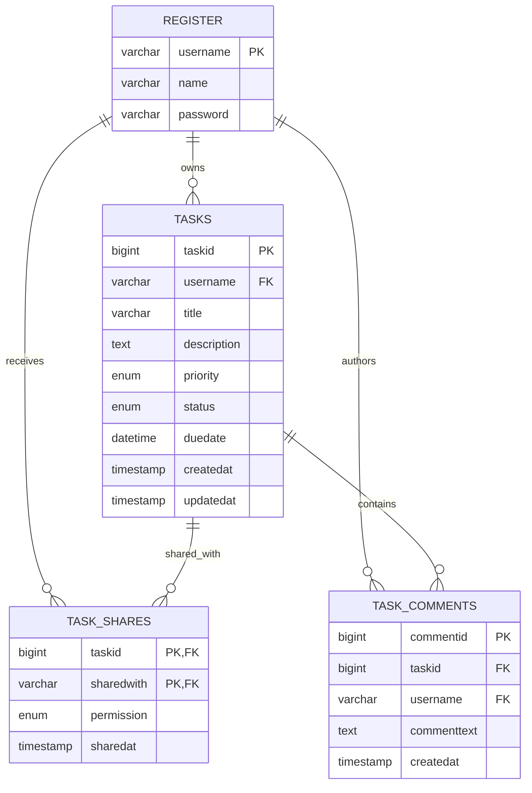
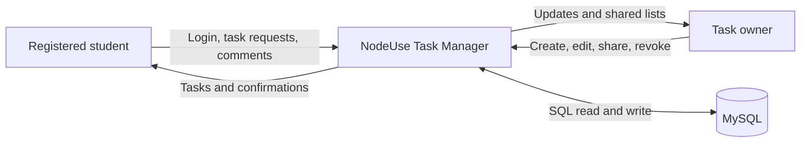
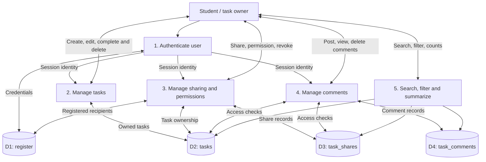

# NodeUse Task Manager V2 — System Design

Backend: Express.js + EJS + mysql2/promise. Host: https://snode.learnwithchampak.live/tasks

## ER diagram

## DFD Level 0 — Context

## DFD Level 1 — Processes and stores

## Access policy

- Owner: view, edit, change status, share, revoke, delete, comment, moderate comments.
- Editor: view, edit, change status, comment and remove own comments.
- Viewer: view, comment and remove own comments.
- A user without access gets a 404 for private tasks.
- Deleting a task cascades to comments and sharing rows.
- A registered username is required for sharing.
- Use POST + CSRF for task mutations, and parameterized SQL for data values.

## Demo routes

- GET /tasks — dashboard, filters, search and statistics
- GET/POST /tasks/new — create task
- GET /tasks/:id — details, sharing and comments
- GET/POST /tasks/:id/edit — edit
- POST /tasks/:id/status — change status
- POST /tasks/:id/delete — owner-only delete
- POST /tasks/:id/share — owner-only share or change permission
- POST /tasks/:id/unshare — owner-only revoke
- POST /tasks/:id/comments — add comment
- POST /tasks/:id/comments/:commentId/delete — author or owner deletes
- GET /tasks/shared — redirects to shared filter

## Deployment

GoDaddy Airo is connected to the `main` branch of the NodeUse repository. Select Update Preview and Publish to Live. The MySQL account needs CREATE TABLE and foreign-key permissions. Verify with two registered demo accounts, then test cross-user access. The teaching registration system stores plaintext passwords; do not use real passwords.
