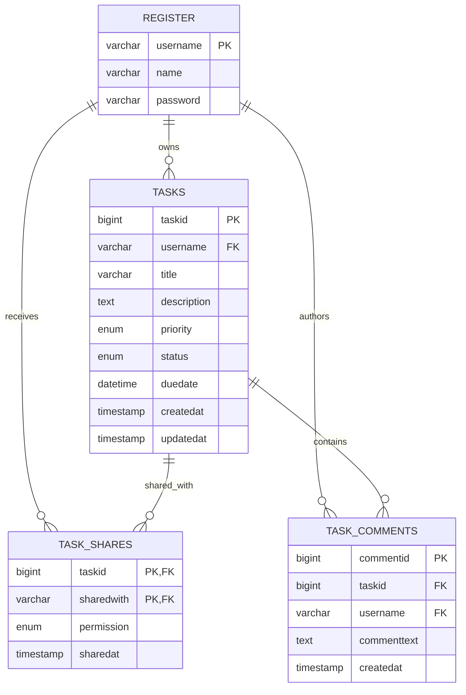
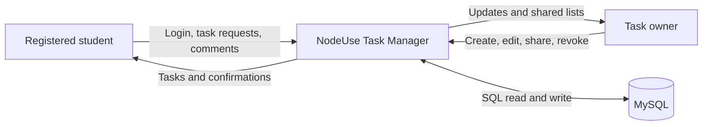
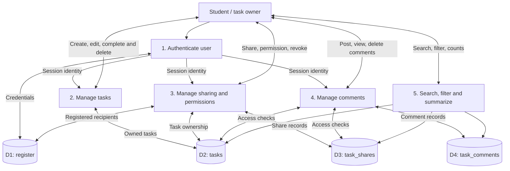

### MySQL table collision fix (10 November 2026)

The GoDaddy runtime log showed `ER_BAD_FIELD_ERROR: Unknown column 't.taskid' in 'where clause'`. An existing generic `tasks` table did not have the expected NodeUse schema. To avoid modifying any pre-existing tables or data, the Task Manager now uses three dedicated physical tables: `nodeuse_tasks`, `nodeuse_task_shares`, and `nodeuse_task_comments`. Routes remain `/tasks` and students still use the existing `register` table. The ER diagram entities labeled TASKS/TASK_SHARES/TASK_COMMENTS map to these namespaced tables. Existing rows in old generic tables are intentionally untouched and not automatically migrated.
# NodeUse Task Manager V2 — System Design

Backend: Express.js + EJS + mysql2/promise. Host: https://snode.learnwithchampak.live/tasks

## ER diagram

## DFD Level 0 — Context

## DFD Level 1 — Processes and stores

## Access policy

- Owner: view, edit, change status, share, revoke, delete, comment, moderate comments.
- Editor: view, edit, change status, comment and remove own comments.
- Viewer: view, comment and remove own comments.
- A user without access gets a 404 for private tasks.
- Deleting a task must explicitly delete its comments and sharing rows in the same transaction, because physical foreign keys are not required by the compatibility schema.
- A registered username is required for sharing.
- Use POST + CSRF for task mutations, and parameterized SQL for data values.

## Demo routes

- GET /tasks — dashboard, filters, search and statistics
- GET/POST /tasks/new — create task
- GET /tasks/:id — details, sharing and comments
- GET/POST /tasks/:id/edit — edit
- POST /tasks/:id/status — change status
- POST /tasks/:id/delete — owner-only delete
- POST /tasks/:id/share — owner-only share or change permission
- POST /tasks/:id/unshare — owner-only revoke
- POST /tasks/:id/comments — add comment
- POST /tasks/:id/comments/:commentId/delete — author or owner deletes
- GET /tasks/shared — redirects to shared filter

## Deployment

GoDaddy Airo is connected to the `main` branch of the NodeUse repository. Select Update Preview and Publish to Live. The MySQL account needs CREATE TABLE and foreign-key permissions. Verify with two registered demo accounts, then test cross-user access. The teaching registration system stores plaintext passwords; do not use real passwords.

## GoDaddy MySQL compatibility update (10 November 2026)

The initial `CREATE TABLE` commands declared foreign keys referencing the existing `register` table. On GoDaddy MySQL, an existing parent table may use a different collation or storage engine, causing task schema initialization to fail (often `ER_CANNOT_ADD_FOREIGN` or MySQL errno 150). The updated setup creates the three task tables without database-enforced foreign keys and does not alter the `register` table. **The ER diagram shows logical relationships, not physical foreign-key constraints.** Task ownership, sharing access, recipient existence and deletion of related records must therefore be enforced by the application.

A signed-in user can inspect `/tasks/db-status` for the database setup status and MySQL error code. On deployment, restart/publish the app to re-run schema initialization. Tables are created with `CREATE TABLE IF NOT EXISTS`, so existing tables and records remain untouched.
